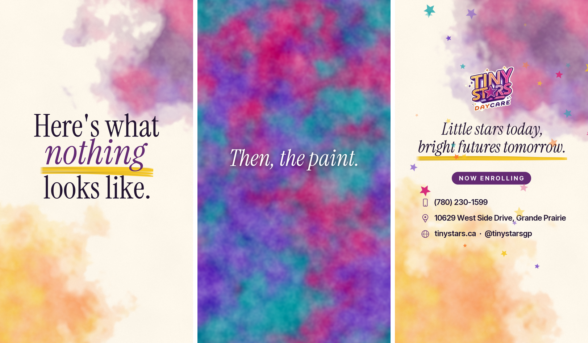

# Tiny Stars daily reels

Code that turns a day's phone clips from [Tiny Stars Daycare](https://tinystars.ca) (Grande Prairie, Alberta) into a short, cinematic film in two versions: a vertical reel for Instagram, Facebook and TikTok, and a full-screen widescreen cut for the 55-inch TV at the daycare. **Every face is blurred**, kids and staff alike, along with children's names on plates and walls, and every cut lands on the beat of the music.



*The graphics on their own. The finished reel puts them around the classroom footage, which is not in this repo.*

## The first film: "Nothing"

Every parent asks "What did you do at daycare today?" and gets "Nothing." The reel (1080×1920, 30 fps, H.264 + AAC, normalised to −14 LUFS, 25 seconds) opens on that exchange, then:

- a **watercolour paint bleed** opens a paper title card: "Here's what nothing looks like."
- the band comes in on the marshmallows and spaghetti, and the **marshmallow tower** challenge is shown step by step in close-up: push the spaghetti in, add more legs, let go.
- the tower stays up, and only then does "Nothing." get struck through with a brush stroke: *Engineering.*
- the song stops dead while paint spreads across a frozen frame, then comes back on the **washable paint** table: *Fine art.*
- the camera tilts up the whole classroom to its stained-glass window: "Nothing. Just growing up."
- a last paint bleed opens the closing card, with contact details landing on the song's final notes and stars on its last hit.

## The second film: "While you're at work"

A 25-second paid ad, told as the updates a working parent gets from the daycare during the day.

**The hook** opens on the best moment of the day: a teacher's hand swooping in for a high five, with her real "High five!", under "What your kid does while you're at work". The picture stops a hair before the hands meet, then rewinds to the morning, so the viewer waits for the payoff. The day then plays in order, each part arriving as an update on a phone:

- **9:52 AM, Outside time ☀️**: the band comes in on a kick, the ball is caught by the fence, and the toddler walks on across the yard.
- **11:18 AM, Music time 🎶**: a boy claps, then dances, arms flung wide, in two shots.
- **1:34 PM, Little helper 💧**: a girl puts her water bottle back on the table, and the high five from the opening finally lands, in slow motion with its real slap.
- **4:05 PM, Ready for pickup 🎒**: the classroom, quiet again.

Only the steadiest footage is used. `updates.py` measures each clip's shake from the camera motion that `detect.py` records, and smooths the handheld yard clips along that path.

Older updates stack up behind the new one, and the last one is the invitation: **Now enrolling ⭐ Book a tour**. The song is "Acoustic Upbeat" by OctoSound; every cut lands on its beat, and the film ends on the song's own last chord.

`updates.py` makes three versions from one timeline, each laid out for its own screen:

| Version | File | Format |
| --- | --- | --- |
| Reels, Stories, TikTok | `exports/updates_reel.mp4` | 1080×1920, every word inside the 720×1200 band the apps leave clear of their buttons |
| Facebook and Instagram feed | `exports/updates_feed.mp4` | 1080×1350 (4:5) |
| TV | `exports/updates_tv.mp4` | 1920×1080, full screen, every shot framed again |

Ad copy and setup notes are in [`exports/updates_ad.md`](exports/updates_ad.md).

## Two versions of every film

| Version | File | Format |
| --- | --- | --- |
| Phone | `exports/nothing_reel.mp4` | 1080×1920, H.264 |
| TV | `exports/nothing_tv.mp4` | 1920×1080, H.264 High 4.2, full screen with no bars or side panels |

`film.py` makes both. The TV version is a real re-edit rather than a resize: the story, the timing and the music are the same, but every shot is framed again and every title is laid out again for a wide screen, through `FRAMING` and `LAYOUT` in `edits/content.py`.

Wide shots show more of the room, so `review_wide.py` shows each landscape clip's whole frame for checking by eye, and anything the phone crop used to hide gets blurred too. The vertical clips stay at the phone film's zoom, which keeps them inside what was already checked.

## Privacy first

The photos, the videos and everything rendered from them stay out of git (see `.gitignore`). Each step has its own script, and the blur is baked in before anything else touches the footage, so no effect can ever work from an unblurred frame:

1. `detect.py` finds faces in every frame with OpenCV's YuNet, at several sizes and four rotations, because a lot of daycare footage is shot from above and faces can be sideways or upside down. It also measures the camera's motion.
2. `track.py` links detections into a smooth track per person. Every track is checked by eye through the film's own framing with `review.py`, and the decisions go in `edits/faces.json`.
3. `blur.py` pixelates and heavily blurs each face inside a feathered ellipse, plus any hand-placed tracks and wall patches for children's names.
4. `verify.py` looks through the finished film for anything that still reads as a face, and puts every hit on a sheet for checking by eye.

## Run it

You need Python 3.12, [uv](https://docs.astral.sh/uv/) and `ffmpeg` on your PATH. None of the media is in the repo, so put the day's clips and photos in the folder named by `RAW` in `edits/content.py` first.

```bash
uv venv --python 3.12 .venv
uv pip install --python .venv/Scripts/python.exe -r requirements.txt
.venv/Scripts/python.exe -I tools/fetch_assets.py          # fonts, face model, logo, song
.venv/Scripts/python.exe -I edits/detect.py                # every face in every frame, plus the camera's motion
.venv/Scripts/python.exe -I edits/track.py --sheets        # link them into tracks, with sheets for checking by eye
.venv/Scripts/python.exe -I edits/review.py stand          # one shot's tracks, through the film's framing
.venv/Scripts/python.exe -I edits/review_wide.py           # every shot's whole frame, for what the TV version will reveal
.venv/Scripts/python.exe -I edits/blur.py                  # bake the blur into 4K working copies
.venv/Scripts/python.exe -I edits/photos.py IMG_8597       # the same for a photo
.venv/Scripts/python.exe -I edits/film.py --stills 1 9 22  # check frames
.venv/Scripts/python.exe -I edits/film.py                  # the reel, with music and without, its cover and the TV version
.venv/Scripts/python.exe -I edits/film.py --tv             # just the TV version (add --stills 1 9 22 to check frames)
.venv/Scripts/python.exe -I edits/verify.py                # the final privacy scan (name a video to scan the TV version)
.venv/Scripts/python.exe -I edits/updates.py --stills 1 9 22  # the ad: check frames (add --feed or --tv for the other layouts)
.venv/Scripts/python.exe -I edits/updates.py               # the ad in all three versions
```

The privacy scripts look for originals in every `source/*_raw` folder, so each film's clips can stay in the folder for the day they were filmed.

The song, the shots, the timing (in beats) and the words all live in `edits/content.py`. `film.py` writes every frame to `work/frames.rgb` before encoding, so it needs about 5 GB of free disk but little memory. If it stops, run it again and it carries on from the last finished frame.

The logo in `tools/fetch_assets.py` is the small one from the website. Put a larger one at `brand/logo_hd.png` and the film uses that instead.

## Tech stack

- **Python** with NumPy, OpenCV (YuNet face detection, optical-flow slow motion, compositing) and Pillow (lettering and graphics, `pillow-heif` for iPhone photos)
- **FFmpeg** for H.264/AAC encoding and two-pass EBU R128 loudness normalisation
- **Fonts:** Instrument Serif for the big words and Inter Tight for small print, plus Crimson Pro Italic for the ad's closing line, all from Google Fonts (OFL). The ad's emoji come from Segoe UI Emoji, which ships with Windows.
- **Music:** "Cinematic Corporate" by alex-morgan on [Pixabay](https://pixabay.com/music/corporate-cinematic-corporate-556231/) for "Nothing", and "Acoustic Upbeat" by OctoSound on [Pixabay](https://pixabay.com/music/happy-childrens-tunes-acoustic-upbeat-301015/) for the ad (Pixabay Content License). The brush, boom and chime sounds are made in `film.py` and `updates.py`.

## License

The code is MIT licensed (see `LICENSE`). The Tiny Stars name and logo belong to Tiny Stars Daycare. The fonts, the face model and the music keep their own licenses.
